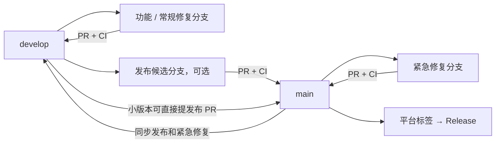

# 开发、合并与发布

Windows、Android 和服务端代码在同一仓库中按目录划分，共用代码只维护一份。
`main` 是稳定发布线，`develop` 是日常集成线；平台通过构建入口和版本标签区分，不再长期维护 `android`、`windows` 或 `server` 平台分支。

## 分支划分

| 分支 | 从哪里创建 | 用途与合入方向 |
| --- | --- | --- |
| `main` | 稳定主线 | 只接收发布准备或线上紧急修复；不直接堆放日常功能 |
| `develop` | `main` | 合入已验证功能，持续运行三端 CI；达到发布条件后通过 PR 合入 `main` |
| `codex/feat/<范围>-<功能>` | `develop` | 一项功能一条分支，PR → `develop`，合并后删除 |
| `codex/fix/<范围>-<问题>` | `develop` | 常规修复，PR → `develop`，合并后删除 |
| `codex/docs/<主题>` | `develop` | 文档整理，PR → `develop`，合并后删除 |
| `codex/release/<版本>` | `develop` | 需要冻结候选版时才创建，PR → `main`；修复再同步回 `develop` |
| `codex/hotfix/<范围>-<问题>` | `main` | 线上紧急修复，PR → `main`，随后 `main` → `develop`，避免下次发布丢失修复 |

范围使用 `android`、`windows`、`server`、`shared` 或 `ci`。例如 `codex/feat/android-chat-search`。
这些名称表示短期任务范围，分支仍包含完整仓库，不复制共享代码。
多个 Codex 会话分别使用自己的分支和 worktree，不共用 Git 索引，不同时修改或提交同一工作区。



## 日常开发与合并

1. 同步 `develop` 后创建任务分支；一个分支只处理一个明确问题。
2. 本地运行受影响的测试，显式选择提交文件，检查配置和密钥未进入提交。
3. 推送任务分支，创建以 `develop` 为目标的 PR。PR 写清变化、验证结果及尚未验收的范围。
4. CI 通过、冲突解决后合并；共享协议、认证、数据格式、资源或媒体变化须同时检查 Windows、Android 和服务端兼容性。
5. 合并后删除短期分支。本地工作区没有未保存文件且产物已整理后，再回收 worktree。

```powershell
git fetch origin --prune --tags
git switch develop
git pull --ff-only origin develop
git switch -c codex/feat/android-chat-search
# 修改并验证，然后显式选择文件
git add -- <本次修改的文件>
git commit -m "feat(android): add chat search"
git push -u origin HEAD
# 在 GitHub 创建 PR：codex/feat/android-chat-search → develop
```

同步目标分支时普通 `merge` 即可。禁止强推或重写已公开的历史。
任务 PR 可 squash，但 `develop → main`、`main → develop` 及平台历史整合使用普通 merge，保留分支之间的祖先关系，避免反复搬运同一批提交。
不要从旧的安装包目录、云端源码副本或长期平台分支开始新功能。

## CI 与发布

| 操作 | 自动行为 |
| --- | --- |
| push 到 `main`、`develop`、`codex/**` | Linux 回归、Windows 构建/测试、Android APK 构建与审计；结果和测试 APK 在 Actions 查看 |
| PR → `main` / `develop` | 验证候选合并源码；通过后才合并。PR 不接收正式安卓签名或生产配置 |
| `main` 上的 `vX.Y.Z` 标签 | 现有 Windows 安装包与后端发布/部署流程 |
| `main` 上的 `android-vX.Y.Z` 标签 | Android 签名 APK 与 GitHub Release；安卓公网更新入口仍按现有发布事务独立激活 |
| 普通分支提交 | 不替换云端业务程序，不切换任何公网更新清单 |

正式标签必须指向 `main` 可达、CI 已通过的提交，创建后不移动、不覆盖。
Windows/后端沿用 `v` 前缀，Android 沿用 `android-v` 前缀；两个平台可独立发布，不要求版本号强行相同。
发布准备时更新对应 CMake 版本和该平台需要的发布元数据，确保源码、程序、安装包与清单一致。
Android 的版本名在 `CppChatAndroid/CMakeLists.txt`，单调递增的版本号在 `CppChatAndroid/app/CMakeLists.txt`；发布沿用现有固定签名。
更新内容写在 GitHub Release / 专用发布元数据中，根 README 只保留介绍和入口。

发布前先记录准确的提交 SHA：

```powershell
git fetch origin --tags
git switch main
git pull --ff-only origin main
git rev-parse HEAD
# 核对对应版本与 CI 后，二选一；不要把示例当作当前版本
git tag -a vX.Y.Z -m "Windows and server X.Y.Z"
git tag -a android-vX.Y.Z -m "Android X.Y.Z"
# 只推送本次平台标签，不批量推送所有本地标签
git push origin <本次平台标签>
```

Android CI 使用同一个固定发布签名；PR 使用隔离测试签名。
Windows 和 Android 公网更新发布共用 Nginx 配置，平台发布必须保留另一平台的路由、清单和安装包。
云端配置、MySQL、Redis、SMTP 与业务数据独立保存；发布源码不等于迁移数据，不执行首次初始化或自动导入 SQL。
需要变更数据库时，另行评审 `database/` 中的迁移及备份方案。

## 分支保护建议

- `main`、`develop` 要求 PR 和 CI，通过后才能合并；禁止强推和删除长期分支。
- 单人维护时保留 PR 检查，但不强制“另一人批准”，避免自己无法批准自己的 PR。
- 必需检查应使用实际运行产生的唯一检查名称，不能把定时任务或只在发布标签运行的任务设为每个 PR 的门槛。
- 这些仓库设置需在 GitHub Rulesets / Branch protection 中配置；本文件本身不会自动开启保护。

## 当前平台分支的迁移

将原 `android` 历史通过普通 merge 合入统一源码，保留主线已有的 Windows 版本、严格发布回归和原生文件探测，完整保留移动端及其依赖许可。
CI 切换到 `main` / `develop` 后，两个长期分支都包含全部平台目录。
旧平台标签和 Release 保持不变；原 `android` 分支完成校验、确认无未合并开发后退出日常使用。
历史安装包、当前云端运行版本不会因为创建或合并分支而自动更新。

## 依据与选择

参考 [GitHub flow](https://docs.github.com/en/get-started/using-github/github-flow) 的短期任务分支、PR 与 CI，
以及 [VS Code 发布流程](https://github.com/microsoft/vscode/wiki/Release-Process) 的主线/候选发布分离与修复回流。
本项目有三端共享实现、独立发布节奏和多个并行开发会话，因此增加一条 `develop` 集成线，
不为每个平台长期分叉，也不为每个已发布版本永久保留分支；只有确实维护旧版补丁时才保留对应发布维护线。
版本通过 [Git tags 与 Releases](https://docs.github.com/en/repositories/releasing-projects-on-github/about-releases) 标识，
保护配置参考 [GitHub 分支保护](https://docs.github.com/en/repositories/configuring-branches-and-merges-in-your-repository/managing-protected-branches/about-protected-branches)。
这里只借鉴管理方法，不复制第三方业务源码，不新增运行依赖或改变现有许可证。
